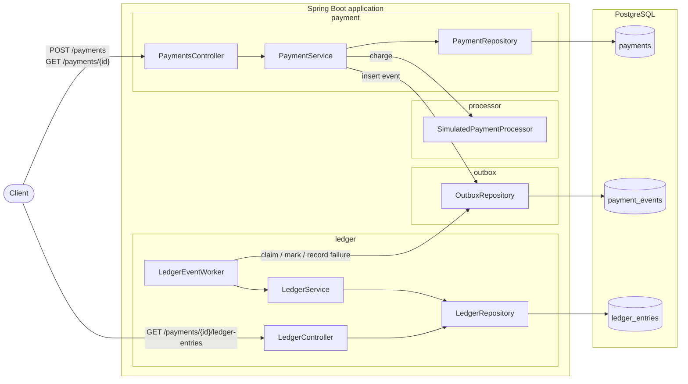
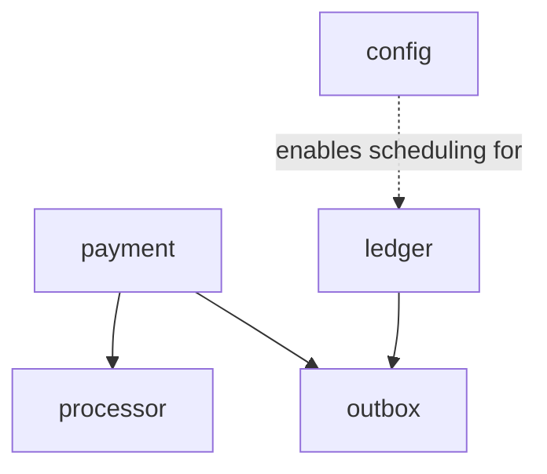
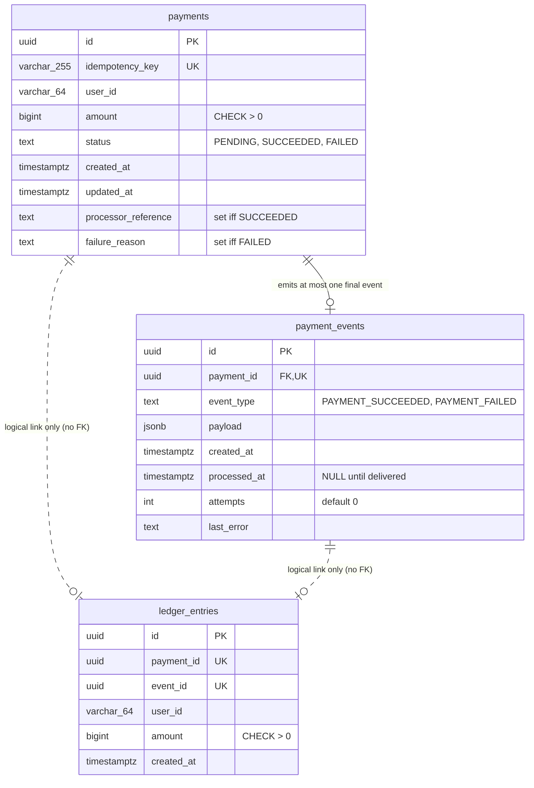
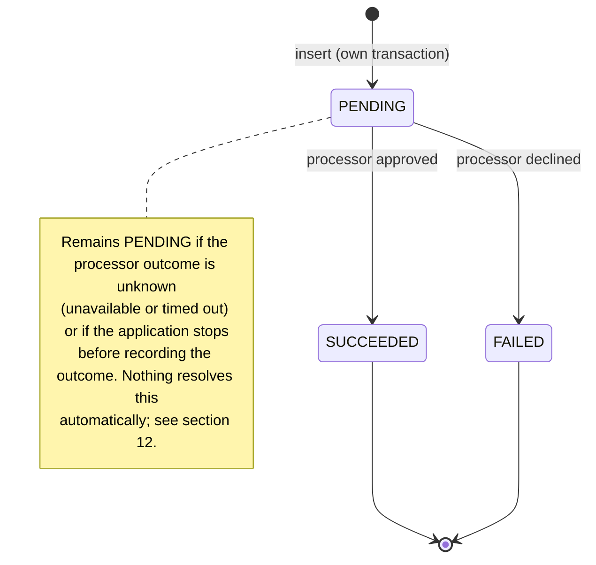
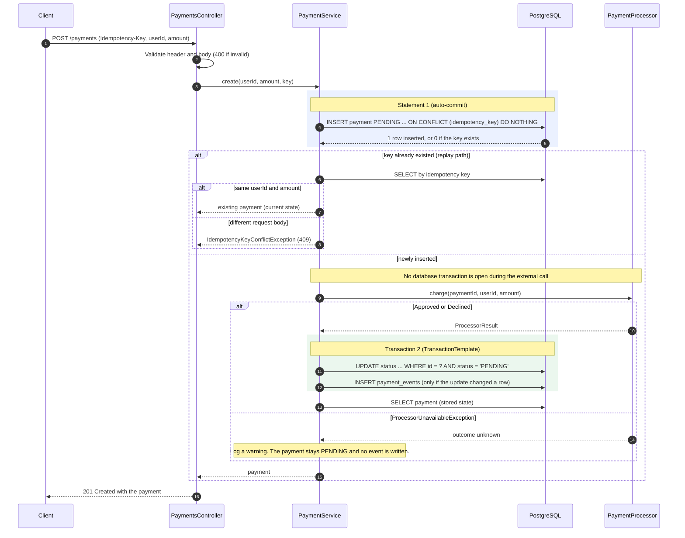
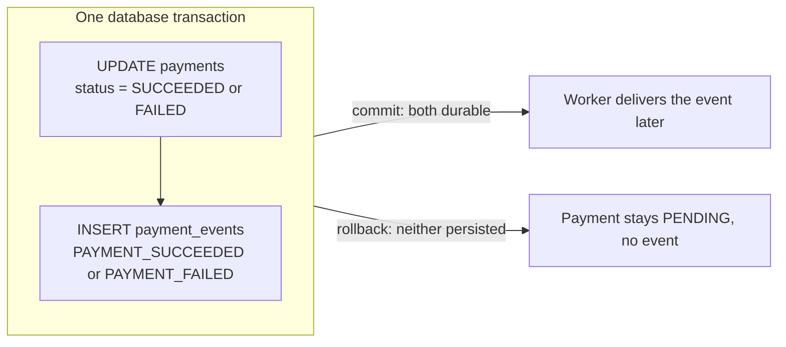
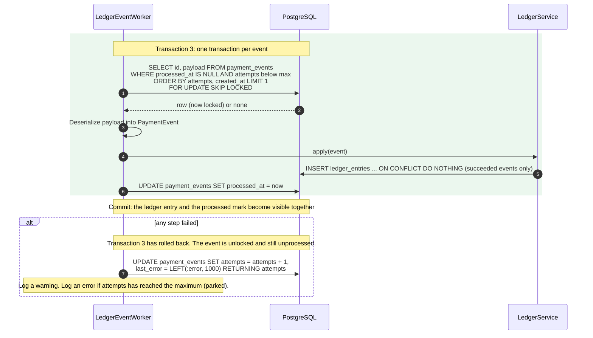
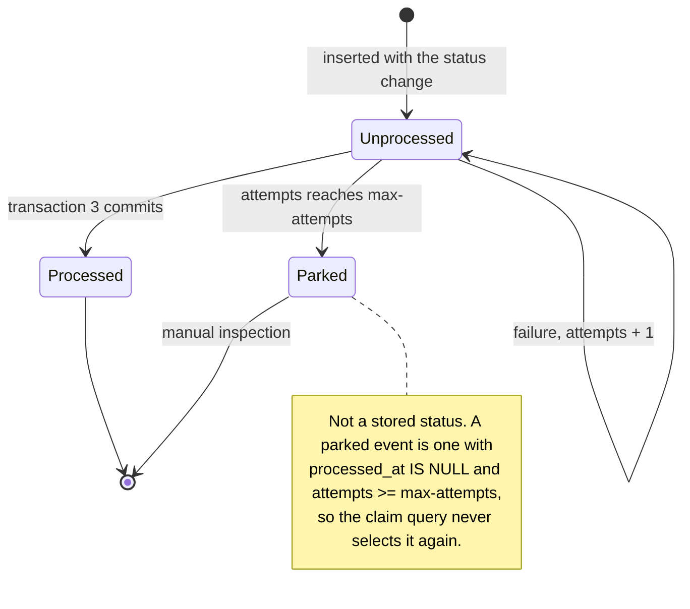
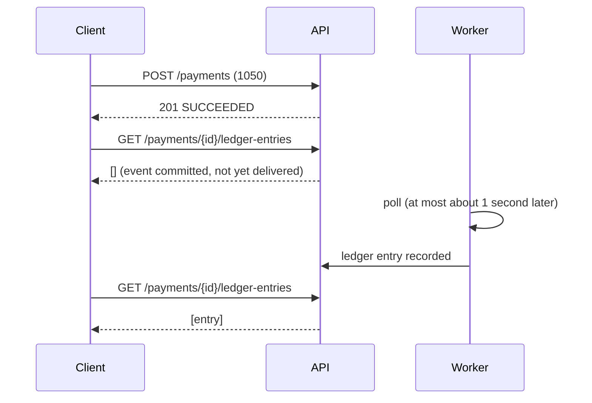

# Payment Ledger: Architecture and Design

This document describes the structure of the payment ledger sample, the behavior of each component, and the reasoning behind the main design decisions. It is derived from the implementation and is intended to be read alongside the code.

**Contents**

1. [Purpose and scope](#1-purpose-and-scope)
2. [System overview](#2-system-overview)
3. [Module structure](#3-module-structure)
4. [Data model](#4-data-model)
5. [Payment lifecycle](#5-payment-lifecycle)
6. [Creating a payment](#6-creating-a-payment)
7. [Processor integration boundary](#7-processor-integration-boundary)
8. [Transactional outbox](#8-transactional-outbox)
9. [Asynchronous delivery: the ledger worker](#9-asynchronous-delivery-the-ledger-worker)
10. [Ledger](#10-ledger)
11. [Read API and consistency model](#11-read-api-and-consistency-model)
12. [Failure analysis](#12-failure-analysis)
13. [Guarantees](#13-guarantees)
14. [Testing strategy](#14-testing-strategy)
15. [Operations](#15-operations)
16. [Alternatives considered](#16-alternatives-considered)
17. [Evolution toward production](#17-evolution-toward-production)
18. [Appendix: API reference](#appendix-api-reference)

---

## 1. Purpose and scope

The application accepts payment requests, charges them through a simulated external processor, records the outcome, and asynchronously reflects successful payments in a ledger. A reviewer can create a payment and then inspect both the payment and its ledger history through a REST API.

The sample is deliberately small. Its purpose is to show how a backend handles **correctness under retries, concurrency and partial failure** without adding infrastructure that the problem does not require.

### Goals

- Accept payments with **idempotent request handling**, including concurrent duplicate requests.
- Keep the external processor call **outside any database transaction**.
- Make each payment status change and its outgoing event **atomic**.
- Deliver events to the ledger **asynchronously and durably**, surviving restarts.
- Make the ledger **idempotent**, so redelivered or duplicate events are harmless.
- Retry failed deliveries, isolate failures, and **park** events that keep failing.
- Prove these properties with tests against a real PostgreSQL database.

### Non-goals

Authentication, multiple currencies or payment methods, refunds and disputes, double-entry accounting, a message broker, multiple deployable services, a recovery process for payments stuck in `PENDING`, and a frontend.

### Technology

| Concern | Choice |
| --- | --- |
| Language and runtime | Java 25 |
| Framework | Spring Boot 4.1 (Spring MVC, Spring JDBC with `JdbcClient`, Bean Validation) |
| Database | PostgreSQL 18 |
| Schema migrations | Flyway (versioned SQL, V1–V5) |
| JSON | Jackson 3 |
| Local database | Docker Compose, started automatically by Spring Boot's Compose support |
| Tests | JUnit, Spring Boot test slices, Testcontainers (PostgreSQL) |
| Build and formatting | Gradle wrapper, Spotless with google-java-format |

---

## 2. System overview

The system is a **modular monolith**: one Spring Boot application and one database, divided internally into modules with explicit boundaries.



There are two independent paths through the system:

- **Synchronous request path.** `POST /payments` stores the payment, charges it, records the outcome and the corresponding event, and returns the payment's final state in the same HTTP request.
- **Asynchronous delivery path.** A background worker, triggered on a fixed delay, reads committed events from `payment_events` and applies them to the ledger.

The two paths communicate only through the `payment_events` table. This is what makes the ledger **eventually consistent** with payments.

---

## 3. Module structure

Code is organized by feature under `com.nielsen`. Each package corresponds to one responsibility.

| Package | Responsibility | Main types |
| --- | --- | --- |
| `payment` | Payment API, idempotent creation, lifecycle, persistence | `PaymentsController`, `PaymentService`, `PaymentRepository`, `Payment`, `PaymentStatus`, request and response records, `IdempotencyKeyConflictException` |
| `processor` | Boundary to the external payment provider | `PaymentProcessor`, `ProcessorResult` (sealed), `ProcessorUnavailableException`, `SimulatedPaymentProcessor` |
| `outbox` | The event contract and its durable storage | `PaymentEvent`, `OutboxRepository`, `ClaimedEvent` |
| `ledger` | Consuming events, recording entries, ledger reads | `LedgerEventWorker`, `LedgerService`, `LedgerRepository`, `LedgerEntry`, `LedgerController`, `LedgerEntryResponse` |
| `config` | Conditional scheduling | `OutboxSchedulingConfiguration` |

### Dependency rules



- `payment` depends on `processor` (to charge) and on `outbox` (to publish).
- `ledger` depends **only** on `outbox`: `PaymentEvent` is its data contract, and `OutboxRepository` provides delivery (claim, acknowledge, record failure).
- `ledger` imports **no** class from `payment` and never reads the `payments` table. Its schema has no foreign keys into payment or outbox tables.

**Why this boundary matters.** The ledger could be extracted into a separate service by replacing the outbox transport, for example with a broker, without changing its business logic. The module boundary is visible in the package tree rather than enforced by interfaces or a framework, which keeps the code small while still making violations obvious in review.

**Why there are few interfaces.** The only interface is `PaymentProcessor`, because it represents a real external system with a realistic alternative implementation (a provider adapter) and a meaningful test substitution. Repositories and services are concrete classes, because there is exactly one implementation of each and the tests run them against a real database rather than mocks.

---

## 4. Data model



### Constraints and what they guarantee

The schema enforces the important rules itself, so they hold no matter which code path, test or manual statement writes the data.

| Constraint | Guarantee |
| --- | --- |
| `payments_idempotency_key_unique` | One payment per idempotency key, even under concurrent requests |
| `payments_amount_positive` | No zero or negative charges |
| `payments_status_valid` | Status is one of the three lifecycle values |
| `payments_processor_reference_consistent` | A payment is `SUCCEEDED` **if and only if** it has a processor reference |
| `payments_failure_reason_consistent` | A payment is `FAILED` **if and only if** it has a failure reason |
| `payment_events_payment_id_unique` | At most one final event per payment |
| `payment_events.payment_id REFERENCES payments` | Events always belong to an existing payment |
| `payment_events_type_valid` | Only known event types are stored |
| `ledger_entries_payment_id_unique` | At most one ledger entry per payment (the business rule) |
| `ledger_entries_event_id_unique` | At most one ledger entry per event (redelivery protection and traceability) |
| `ledger_entries_amount_positive` | The ledger rejects invalid amounts even if an invalid event arrives |

### Indexes

| Index | Serves |
| --- | --- |
| Primary keys | Lookups by ID |
| Unique constraints | `ON CONFLICT` detection and lookups by idempotency key or payment ID |
| `payment_events_unprocessed_attempts_created_at_idx` on `(attempts, created_at) WHERE processed_at IS NULL` | The worker's claim query. As a partial index, it covers only unprocessed rows, so its size stays small however many processed events accumulate. |

### Modeling decisions

- **Amounts are integer minor units (cents) in a `bigint`.** This avoids rounding and the `BigDecimal` equality pitfalls. There is a single implicit currency (USD) and no currency column.
- **Statuses are `text` with a `CHECK` constraint, not a PostgreSQL `ENUM`.** They map directly to `PaymentStatus.name()`, and their allowed values can be changed in a later migration without the restrictions that PostgreSQL places on altering enum types.
- **Timestamps are `timestamptz`.** The domain uses `Instant`, and the repository converts to `OffsetDateTime` in UTC, because JDBC 4.2 maps `TIMESTAMP WITH TIME ZONE` to `OffsetDateTime` and the PostgreSQL driver does not support `Instant` directly. Timestamps are truncated to microseconds in the application so that values read back equal the values written.
- **Event payloads are `jsonb`.** The payload is the message contract between modules and is independent of the `payments` schema.
- **The ledger has no foreign keys.** Consistency between payments and the ledger comes from the outbox, not from referential integrity. This preserves the module boundary.
- **Migrations are append-only.** Each change is a new versioned file. For example, V5 replaces the index created in V3 instead of editing V3, because Flyway validates the checksum of every migration it has already applied.

---

## 5. Payment lifecycle



`SUCCEEDED` and `FAILED` are **terminal**. Transitions are enforced by a conditional update rather than by an in-memory state machine:

```sql
UPDATE payments
SET status = :status, processor_reference = :processorReference,
    failure_reason = :failureReason, updated_at = :updatedAt
WHERE id = :id AND status = 'PENDING'
```

The `AND status = 'PENDING'` condition makes the check and the change one atomic step. If two processes race to complete the same payment, the second one waits for the first one's row lock. PostgreSQL then re-evaluates the `WHERE` clause against the updated row, so the second update affects zero rows. The caller learns the outcome from the row count, without any explicit locking.

---

## 6. Creating a payment

### Sequence and transaction boundaries



### Why the boundaries are placed here

| Decision | Reason |
| --- | --- |
| The insert commits **before** the charge | A durable `PENDING` record exists before any money can move. If the application stops during the call, there is evidence that a charge was attempted. |
| **No transaction** around `charge()` | Holding a transaction (and a pooled connection) open across a network call ties database resources to external latency, and makes the database outcome depend on a remote system's timing. |
| The status update and event insert share **one** transaction | No status change can exist without its event, and no event without its status change. This is the outbox's central guarantee (section 8). |
| The event is written **only if** the update changed a row | A payment that something else already completed produces no second event. `UNIQUE(payment_id)` on `payment_events` backs this up at the database level. |
| `TransactionTemplate` instead of `@Transactional` on `create()` | `@Transactional` on `create()` would include the processor call and delay the first commit. `@Transactional` on the private `processPayment` method would be silently ignored, because Spring applies it through a proxy that calls within the same class bypass. `TransactionTemplate` makes the boundary explicit and exactly as wide as necessary. |

### Request idempotency

The idempotency key is an HTTP header (`Idempotency-Key`), following the convention used by major payment providers and an IETF draft. It describes the request's retry semantics rather than the payment itself.

| Incoming request | Result |
| --- | --- |
| New key | Payment created and charged; `201` with its final state |
| Same key, same `userId` and `amount` | **Replay**: `201` with the stored payment's **current** state; the processor is not called again |
| Same key, different `userId` or `amount` | `409` problem response; the existing payment is unchanged |
| Two requests with the same key **at the same time** | Handled by PostgreSQL. A second `INSERT … ON CONFLICT` waits for the first, uncommitted insert. If that commits, the second request takes the replay path. If it rolls back, the second request inserts and charges its own payment. The processor is called once either way. |

**Why `ON CONFLICT` instead of a pre-check or catching an exception.**

- A `SELECT` followed by an `INSERT` has a race window between the two statements.
- Catching a unique-constraint violation uses exceptions for normal control flow. In PostgreSQL, a failed statement also aborts the surrounding transaction.
- `ON CONFLICT DO NOTHING` performs the check and the insert as one atomic operation and reports the result as a row count.

After a conflict, the subsequent `SELECT` always finds the row. Under PostgreSQL's default isolation level (READ COMMITTED), `ON CONFLICT` reports a conflict only once the competing row is committed, and the next statement takes a fresh snapshot that includes it.

**Why the replay returns the current state.** The service stores payments, not responses. A replay therefore reflects later state changes. For example, a payment that was `PENDING` during the first response could be `SUCCEEDED` on a later replay. This is simpler than storing and replaying response bodies, and it is tested explicitly.

---

## 7. Processor integration boundary

```java
public interface PaymentProcessor {
  ProcessorResult charge(UUID paymentId, String userId, long amount);   // throws ProcessorUnavailableException
}

public sealed interface ProcessorResult {
  record Approved(String processorReference) implements ProcessorResult {}
  record Declined(String reason) implements ProcessorResult {}
}
```

### Modeling the outcomes

The design separates three situations that a payment integration must not confuse:

| Situation | Representation | Payment outcome |
| --- | --- | --- |
| The provider approved the charge | `Approved(processorReference)` | `SUCCEEDED` |
| The provider definitively declined | `Declined(reason)` | `FAILED` |
| **No definitive answer** (timeout, outage) | `ProcessorUnavailableException` | Stays `PENDING`: the charge **may or may not** have happened |

- **Approved and declined are answers, so they are values.** A sealed interface with records gives each outcome exactly its own data: a reference for an approval, a reason for a decline. The service handles them with an exhaustive `switch`, so the compiler rejects reading a field that doesn't belong to an outcome, and fails every unhandled `switch` if an outcome is added later.
- **An unknown outcome is not an answer, so it is an exception.** The system must not guess, because treating a timeout as a decline could hide a charge that actually happened. This also matches how real HTTP clients report timeouts.

### Provider-side idempotency

`charge` receives the `paymentId`, which a real adapter would send as the provider's idempotency key. A retried charge for the same payment would then return the original result instead of charging twice. The simulated processor imitates this: its approval reference is derived from the payment ID (`sim_<paymentId>`), so repeated calls return the same result.

### Simulated behavior

`SimulatedPaymentProcessor` is deterministic, based on the amount in cents:

| `amount % 100` | Result |
| --- | --- |
| `1` (e.g. 1001) | `Declined("insufficient_funds")` |
| `2` (e.g. 1002) | `ProcessorUnavailableException` |
| anything else | `Approved("sim_" + paymentId)` |

This gives predictable success, decline and outage scenarios with no network calls, credentials, randomness or sleeps.

---

## 8. Transactional outbox

### The problem it solves

When a payment completes, two things must happen: the status changes, and the ledger is told. Writing the status to the database and then notifying the ledger separately (in memory, or through a broker) is a **dual write**. A crash between the two steps loses the notification, or delivers a notification for a change that was never committed.

### The solution

The event is written to the `payment_events` table **in the same transaction** as the status change. Once the transaction commits, the event is durable. Delivering it becomes a separate concern, handled by the worker, which can retry indefinitely without involving the payment request.



### The event contract

```json
{
  "eventId": "73239d3b-2da1-4a8d-af5b-f6dad2b39641",
  "type": "PAYMENT_SUCCEEDED",
  "paymentId": "138b317d-b281-4346-a064-0e021cb54ea8",
  "userId": "user-1",
  "amount": 1050,
  "occurredAt": "2026-10-22T03:45:03.067465Z"
}
```

- **Both final transitions produce an event,** including declines. The event reports what happened, and each consumer decides what matters to it.
- **The payload is self-contained.** The ledger needs nothing else and never queries `payments`.
- `eventId` becomes the ledger entry's `event_id`, linking every entry to the event that caused it.
- Some fields are duplicated as columns (`id`, `payment_id`, `event_type`, `created_at`) for constraints, indexing and inspection. Tests check that the columns and the payload agree.

---

## 9. Asynchronous delivery: the ledger worker

### Triggering

`LedgerEventWorker.poll()` is annotated `@Scheduled(fixedDelayString = "${outbox.worker.poll-interval:1s}")` and processes up to 100 events per run.

- **Fixed delay, not fixed rate:** a run starts only after the previous run has finished, so runs never overlap.
- **Scheduling is conditional:** `OutboxSchedulingConfiguration` applies `@EnableScheduling` only when `outbox.worker.enabled` is `true`, which is the default. Tests that load the full application disable it and call the worker directly, which makes them deterministic.

### Processing one event



### Key mechanisms

**Claiming with `FOR UPDATE SKIP LOCKED`.**

- `FOR UPDATE` locks the selected row until the transaction ends, so no other worker can process the same event at the same time.
- `SKIP LOCKED` makes other workers skip that row instead of waiting for it.

A single worker instance is expected, but running several instances would be safe without any change. The lock lasts only while the transaction is open, which is why claiming, applying and acknowledging all happen inside one transaction.

**One transaction per event.** The ledger insert and the processed mark commit or roll back together, and a failure affects only the event being processed. Events earlier in the same batch stay committed.

**Recording failures after the rollback.** The failure is counted in a separate statement that runs only after the processing transaction has rolled back. Incrementing `attempts` inside the failed transaction would roll back with it, and the event would retry forever without ever being counted.

**Catching exceptions outside the transaction callback.** Exceptions propagate out of `TransactionTemplate.execute(...)` so that the template rolls back. Catching them inside the callback would cause a commit of whatever partial work was done.

**Deserializing after the claim.** The payload is parsed only after the event's ID is known. A malformed payload therefore counts as a failure against the correct event, and that event is eventually parked. If parsing happened inside the claim query's row mapper, the error would occur before the ID was known, and the event would permanently block the front of the queue.

**Failures before a claim are not counted.** If the claim itself fails, for example because the database is unavailable, no event can be blamed. The exception propagates, the scheduler logs it, and the next poll tries again.

### Retries, ordering and parking



- **A batch stops at its first failure.** A failing event is attempted at most once per poll, so the poll interval acts as a natural delay between retries, and a failing event cannot use up all its attempts within one batch.
- **Claims are ordered by `attempts, created_at`.** Events that have failed sort behind fresh ones, so one bad event cannot block the queue (no head-of-line blocking).
- **After `max-attempts` failures (default 5), an event is parked.** It stays in the table with its `last_error` for inspection, is excluded from future claims, and the worker logs an error.

### Delivery semantics

Delivery is **at least once**. An event can be applied more than once, for example if a previous attempt wrote its ledger entry but the processed mark was lost. The ledger's idempotency (section 10) turns at-least-once delivery into **at most one ledger entry per payment**. This is not exactly-once delivery: it is at-least-once delivery combined with an idempotent consumer.

---

## 10. Ledger

### What it records

| Event | Ledger effect |
| --- | --- |
| `PAYMENT_SUCCEEDED` | One entry: `payment_id`, `event_id`, `user_id`, `amount` |
| `PAYMENT_FAILED` | Nothing. No money moved. The event is still marked processed. |

The ledger is a **simplified, single-entry record of money received**. It is not a double-entry accounting system: it has no accounts, balances, debits and credits, or offsetting entries.

### Idempotency

```sql
INSERT INTO ledger_entries (id, payment_id, event_id, user_id, amount, created_at)
VALUES (...)
ON CONFLICT DO NOTHING
```

`ON CONFLICT` has **no target** here on purpose, so a conflict on either unique constraint is ignored:

| Duplicate type | Caught by |
| --- | --- |
| The same event delivered again | `UNIQUE(event_id)`, and also `UNIQUE(payment_id)` |
| A different event for an already-recorded payment | `UNIQUE(payment_id)`, which enforces the business rule |
| The same event ID reused for another payment | `UNIQUE(event_id)` |

The ledger never checks for an existing entry with a `SELECT` first, because that would reintroduce the check-then-act race.

### Trust model

The ledger trusts the contents of events after they pass its own constraints (`NOT NULL`, `amount > 0`, uniqueness). That trust rests on the transport:

- Only the payment service inserts events.
- It does so in the same transaction as the status change, so an event cannot exist without the corresponding committed status change.

This is an application convention: there are no separate database permissions for the outbox table. If events moved to a shared broker, where any authorized publisher can send any message, the ledger would need an explicit trust policy, such as restricted publishing, signed events, or re-reading the authoritative payment state before recording.

---

## 11. Read API and consistency model

| Endpoint | Source | Notes |
| --- | --- | --- |
| `GET /payments/{id}` | `payments` | `404` if unknown, `400` if the ID is not a UUID |
| `GET /payments/{id}/ledger-entries` | `ledger_entries` only | JSON array; `[]` if no entries |

The ledger endpoint is served by the `ledger` module from its own table. It is nested under `/payments` because that matches how a client thinks about it, but the URL's location does not create a dependency between the modules. The endpoint does not check whether the payment exists, so `[]` can mean "not yet delivered", "declined" or "unknown payment". A composition layer could return `404` for unknown payments by calling both modules' services, without adding a dependency from the ledger to payments.

### Eventual consistency



The payment's status is final as soon as `POST` returns. The ledger catches up within roughly one poll interval. A local run measured about 0.8 seconds between payment creation and the ledger entry.

---

## 12. Failure analysis

| # | Scenario | What happens | Resulting state | Handling |
| --- | --- | --- | --- | --- |
| 1 | Invalid request | Validation fails before the service is called | Nothing stored | `400` problem response |
| 2 | Client retries the same request | Insert conflicts; same body | Unchanged | Replay; no second charge |
| 3 | Key reused with a different body | Insert conflicts; body differs | Unchanged | `409` |
| 4 | Concurrent duplicate requests | Second insert waits for the first | One payment | One charge (tested for both commit and rollback of the first insert) |
| 5 | Declined | Transaction 2 stores `FAILED` and a `PAYMENT_FAILED` event | `FAILED` | Ledger records nothing |
| 6 | Processor unavailable or timed out | Exception; no update | `PENDING`; **the charge may have happened** | Logged. **No automatic recovery.** |
| 7 | Crash after insert, before charge | No charge happened | `PENDING` | No automatic recovery |
| 8 | Crash after charge, before transaction 2 | Outcome lost locally | `PENDING`; **money may have moved** | Requires reconciliation with the provider |
| 9 | Transaction 2 fails (e.g. event insert) | Status update rolls back with it | `PENDING`; `500` to the client; **money moved** | Requires reconciliation |
| 10 | Crash after transaction 2 commits | Event is durable | Event unprocessed | Delivered after restart |
| 11 | Ledger write fails | Transaction 3 rolls back; failure recorded | Event unprocessed, `attempts + 1` | Retried on later polls; parked after 5 |
| 12 | Crash during transaction 3 | Rollback | Event unprocessed | Redelivered; idempotent |
| 13 | Event delivered twice | `ON CONFLICT DO NOTHING` | One entry | Harmless |
| 14 | Malformed payload | Parse fails after claim | Failure counted against the right event | Parked after retries |
| 15 | Crash between rollback and failure recording | Attempt not counted | Event unprocessed | One extra retry beyond the limit; acceptable |
| 16 | Two workers running | `SKIP LOCKED` | Each event claimed once | Safe |
| 17 | Database unavailable during polling | Claim fails | Unchanged | Next poll retries; no attempt counted |

**Stuck `PENDING` (rows 6–9) is the main known gap.** It covers the cases where the system cannot know whether money moved. A replay does not retry the charge. Resolving these payments requires asking the provider for the payment's status, using the payment ID as the key. This is explicitly out of scope and documented as a limitation.

---

## 13. Guarantees

**Guaranteed, for writes through the application:**

- At most one payment per idempotency key, including under concurrency.
- At most one charge attempt per payment from this service.
- A final status and its event are committed together or not at all.
- Final payments never change status again.
- A payment's status, processor reference and failure reason are always consistent (enforced by the database).
- Every committed event is delivered to the ledger at least once, unless it is parked.
- At most one ledger entry per payment, and no entry for declined payments.
- A ledger entry and its event's processed mark are committed together or not at all.

**Not guaranteed:**

- Exactly-once delivery. Delivery is at least once, and the consumer is idempotent.
- Resolution of payments stuck in `PENDING`.
- Delivery of parked events (they require manual action).
- Detection of conflicting duplicates. A second event for a recorded payment with a different amount is ignored, not flagged.
- Protection against direct, manual database writes that bypass the application.

---

## 14. Testing strategy

Tests run against **real PostgreSQL** (Testcontainers), because the guarantees depend on PostgreSQL behavior: constraints, `ON CONFLICT`, row locks, `SKIP LOCKED`, `jsonb` and transaction isolation. Mocks are used only at the HTTP boundary and to inject failures.

| Level | Annotation | Transactions | Covers |
| --- | --- | --- | --- |
| Unit | none | n/a | Simulated processor outcomes |
| Web slice | `@WebMvcTest` | none (service mocked) | Validation, status codes, problem responses, JSON shape |
| Repository | `@JdbcTest` | rolled back after each test | SQL, mapping, constraints, conditional updates |
| Service and worker | `@JdbcTest` + `@Transactional(NOT_SUPPORTED)` | **real commits**, explicit cleanup | Transaction boundaries, atomicity, rollback, retries, parking, locking, concurrency |
| End to end | `@SpringBootTest` + `MockMvcTester` | real commits | HTTP → payment → event → worker → ledger read |
| Configuration | `ApplicationContextRunner` | n/a | Scheduling switched on and off |

### Techniques worth noting

- **No sleeps.** Asynchronous delivery is tested by calling `processBatch()` directly. The production scheduler only calls the same method on a timer.
- **Transaction-sensitive tests use real commits.** The default rollback-per-test would hide the behavior under test: inner transactions would join the test's transaction, and other threads could not see uncommitted data.
- **Behavior during the external call is checked from inside it.** A spy on the processor asserts, during `charge()`, that no transaction is active and that the `PENDING` row is already committed.
- **Rollback is tested from both directions.** An event insert that throws, and a failure *after* a successful event insert, both leave the payment `PENDING` with no event.
- **Concurrency is observed, not assumed.** The duplicate-request tests hold one insert open in a transaction, start a competing request on another thread, and wait until `pg_blocking_pids` reports the second request blocked on the first before committing or rolling back. This proves the race actually happened.
- **Lock skipping is tested with two workers:** one holds an event's lock while a second worker on another thread processes a different event.
- **Test data is chosen so that bugs cause failures.** Examples: a different `updatedAt` from `createdAt`, so swapped columns are detected; different amounts for duplicates, so the test can tell which record survived; an unrelated row, so a missing `WHERE` clause is detected.

---

## 15. Operations

### Configuration

| Property | Default | Effect |
| --- | --- | --- |
| `outbox.worker.enabled` | `true` | Enables scheduled polling |
| `outbox.worker.poll-interval` | `1s` | Fixed delay between polls |
| `outbox.worker.max-attempts` | `5` | Attempts before an event is parked |
| `spring.mvc.problemdetails.enabled` | `true` | RFC 9457 problem responses for errors |

### Environments

- **Local development:** `./gradlew bootRun` starts PostgreSQL from `compose.yaml` through Spring Boot's Docker Compose support, discovers the connection details from the container, and runs Flyway.
- **Tests:** each Spring test context starts its own PostgreSQL container with `@ServiceConnection`. Compose is not used.
- **Packaged jar:** Compose support is a development-only dependency and isn't in the jar. The database connection comes from `SPRING_DATASOURCE_URL`, `SPRING_DATASOURCE_USERNAME` and `SPRING_DATASOURCE_PASSWORD`.

### Observability

| Signal | Level | Meaning |
| --- | --- | --- |
| `Processor outcome unknown for payment …` | WARN | Payment left `PENDING` with an unknown outcome |
| `Payment … is no longer pending` | WARN | Another process completed the payment first (unexpected in the current design) |
| `Failed to process payment event …` | WARN | Delivery attempt failed and will be retried |
| `Payment event … parked after … attempts` | ERROR | Requires operator action |

### Inspecting the system

Parked events:

```sql
SELECT id, payment_id, attempts, last_error, created_at
FROM payment_events
WHERE processed_at IS NULL AND attempts >= 5;
```

Reconciliation between payments and the ledger, finding succeeded payments with no ledger entry (including normal delivery lag):

```sql
SELECT p.id, p.amount, p.updated_at
FROM payments p
LEFT JOIN ledger_entries l ON l.payment_id = p.id
WHERE p.status = 'SUCCEEDED' AND l.id IS NULL;
```

---

## 16. Alternatives considered

| Alternative | Why not chosen |
| --- | --- |
| Spring application events with `@TransactionalEventListener` and `@Async` | Very simple, but the event exists only in memory. A crash after the commit loses it, and there is no retry. |
| An in-memory queue or executor | Same failure mode: not durable. |
| A message broker (Kafka, RabbitMQ) | Adds infrastructure for a single in-process consumer. Publishing directly from the request would also be a dual write unless combined with an outbox anyway. |
| PostgreSQL `LISTEN/NOTIFY` | Lower latency, but notifications are not durable and require a dedicated listener connection. Polling also finds work left over after a restart. |
| JPA / Hibernate or Spring Data JDBC | Would hide the SQL that carries the design: `ON CONFLICT`, conditional updates, `FOR UPDATE SKIP LOCKED`. |
| `@Transactional` on `create()` | Would keep a transaction open during the processor call and delay the first commit. |
| A state machine library | Three states and two transitions are enforced more simply and more reliably by a conditional `UPDATE`. |
| A flat result record with an outcome enum and nullable fields | Allows invalid combinations (approved without a reference) that compile without errors. The sealed type makes them unrepresentable and makes `switch` statements exhaustive. |
| H2 for tests | Would not reproduce PostgreSQL's locking, conflict handling or `jsonb`. The tests would not prove the behavior they claim. |
| Separate microservices | Network calls and deployment complexity without benefit at this size. The module boundary keeps extraction possible. |
| Decimal amounts (`numeric`) | Integer cents avoid rounding and `BigDecimal` equality pitfalls. `numeric(…, 2)` would silently round extra decimal places. |

---

## 17. Evolution toward production

| Change | Trigger | Approach |
| --- | --- | --- |
| Resolve stuck `PENDING` | Required for real money movement | A sweeper that queries the provider by payment ID and completes payments through the same conditional update and outbox transaction |
| Publish to a broker | Other services need the events | Keep the outbox as the atomic record of what must be published; a relay publishes rows to the broker |
| Scale delivery | Throughput | Multiple workers already work with `SKIP LOCKED`; add batching if needed |
| Alerting | Operations | Metrics and alerts on parked events, the age of the oldest unprocessed event, and the count of `PENDING` payments |
| Retention | Table growth | Archive or delete processed events after a retention period |
| Authentication and authorization | Any real client | Scope payments and keys per account; return `404` for both unknown and inaccessible payments |
| Conflicting duplicate detection | Ledger integrity | Compare the incoming event with the existing entry and flag mismatches |
| Field-level validation errors | API usability | Add field errors to problem responses (currently the generic "Validation failure") |
| Multi-currency | Product scope | A currency column on payments and ledger entries; validate minor units per currency |
| User ledger history | Product scope | `GET /users/{id}/ledger-entries` with pagination and a `user_id` index |
| Full accounting | Finance requirements | Double-entry accounts and balances, and correction by offsetting entries rather than updates |

---

## Appendix: API reference

### `POST /payments`

Headers: `Content-Type: application/json`, `Idempotency-Key: <1–255 characters>` (required).

```json
{ "userId": "user-1", "amount": 1050 }
```

| Field | Rules |
| --- | --- |
| `userId` | Required, not blank, at most 64 characters |
| `amount` | Required, positive integer, in cents |

Response `201 Created` (also returned for replays):

```json
{
  "id": "138b317d-b281-4346-a064-0e021cb54ea8",
  "userId": "user-1",
  "amount": 1050,
  "status": "SUCCEEDED",
  "createdAt": "2026-10-22T03:45:03.067465Z",
  "processorReference": "sim_138b317d-b281-4346-a064-0e021cb54ea8",
  "failureReason": null
}
```

| Status | When |
| --- | --- |
| `201` | Created, or replayed with the same key and body. `status` may be `SUCCEEDED`, `FAILED` or `PENDING`. |
| `400` | Invalid body, malformed JSON, or a missing, blank or too-long `Idempotency-Key` |
| `409` | The key was already used with a different `userId` or `amount` |
| `500` | Unexpected failure, including a failed outcome transaction (the payment remains `PENDING`) |

### `GET /payments/{id}`

`200` with the payment, `404` if unknown, `400` if `id` is not a UUID.

### `GET /payments/{id}/ledger-entries`

`200` with an array (possibly empty), `400` if `id` is not a UUID.

```json
[
  {
    "paymentId": "138b317d-b281-4346-a064-0e021cb54ea8",
    "eventId": "73239d3b-2da1-4a8d-af5b-f6dad2b39641",
    "userId": "user-1",
    "amount": 1050,
    "createdAt": "2026-10-22T03:45:03.894569Z"
  }
]
```

Validation, conflict and not-found errors use `application/problem+json` (RFC 9457).
